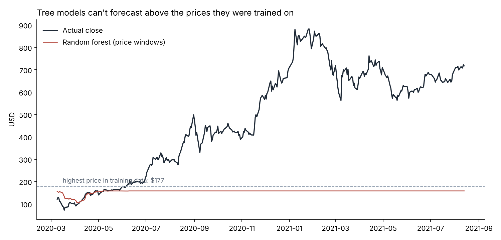
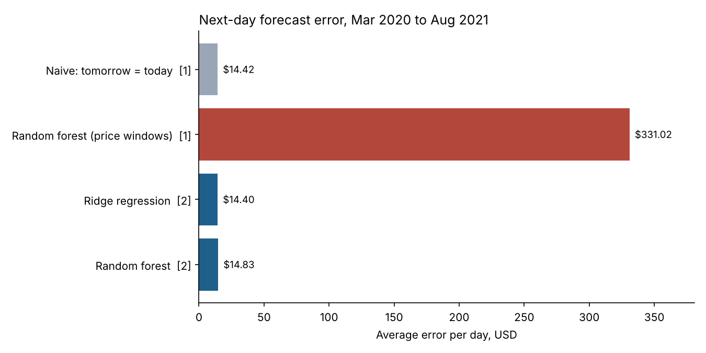

# Tesla Stock: Why My Forecast Failed, and What Works Instead


Five years of daily Tesla (TSLA) prices, from August 2016 to August 2021: 1,258 trading days. The goal is to forecast the next day's closing price.

My [first version](notebooks/01_original_notebook.ipynb) used XGBoost on 15-day windows of scaled prices and reported an error of 0.39. That sounded small until I converted it back to dollars.

## The problem: the model can't forecast prices it has never seen

The first 70% of days (to February 2020) were used for training. In that period Tesla never closed above **$177**. In the test period it rose to **$883**.

Tree-based models like XGBoost and random forests predict by averaging training examples, so **they can never forecast a value higher than the highest one they were trained on**. When Tesla took off in mid-2020, the forecasts flattened out below the old high:



| Model (Part 1: price windows) | Average error per day | Highest forecast |
|---|---|---|
| Naive: tomorrow's price = today's | **$14.42** | n/a |
| XGBoost, original settings | $332.48 | $157.12 |
| Random forest | $331.02 | $158.72 |

The original "0.39 error" was on a 0-to-1 scale. In dollars, it was off by more than $300 a day, about 23 times worse than doing nothing clever at all.

## The fix: forecast the daily change, not the price

Instead of predicting the price, Part 2 predicts tomorrow's **percentage change** from the last 15 daily changes, then applies it to today's price. Daily changes stay in a similar range whether the stock is at $50 or $800, so the models are no longer asked to predict outside what they've seen.

Every model is tested on the same days as Part 1.



| Model (Part 2: daily returns) | Average error per day | Direction right (up or down) |
|---|---|---|
| Naive: tomorrow's price = today's | $14.42 | n/a |
| Always predict "up" | n/a | 54.0% |
| Ridge regression | **$14.40** | 52.9% |
| Random forest | $14.83 | 50.4% |
| XGBoost | $15.56 | 47.7% |

## What this shows

- **The returns approach fixes the $300 error.** Every model is now in the same range as the naive forecast.
- **No model reliably beats "tomorrow = today".** The best, ridge regression, is 2 cents better per day, which is noise, and XGBoost is about $1 a day worse. None of them predicts the direction better than always guessing "up" (54%, because Tesla rose on most days in this period).
- **That's the expected result.** Past prices alone carry very little information about tomorrow's move, which is what the efficient-market idea predicts. A model claiming much better results from price history alone usually has a leak or a scaling mistake, like my first version.
- **The lesson I'd apply elsewhere:** always convert errors back to real units and compare against a naive baseline before trusting a model. And check whether the test data goes outside the training range.

## Other fixes from the first version

- **Scaler fitted on training days only.** The original fitted it on all 1,258 days, so information about the test period's highs leaked into training.
- **Errors reported in dollars**, not on a 0-to-1 scale.
- **Tests** check that no feature uses future prices and that training and test periods don't overlap.

## Run it yourself

```bash
git clone https://github.com/ranzith1282000-beep/tesla-stock-forecasting.git
cd tesla-stock-forecasting
pip install -r requirements.txt
python src/forecast.py   # writes results/results.csv and the charts in images/
pytest                   # 5 tests
```

## Repository layout

```
├── src/forecast.py                       both parts, charts and results
├── tests/test_forecast.py                no-look-ahead and split checks
├── data/TSLA.csv                         daily prices, Aug 2016 to Aug 2021
├── results/results.csv
├── images/
└── notebooks/01_original_notebook.ipynb  my first version
```

## Tools

Python, pandas, NumPy, scikit-learn, XGBoost, Matplotlib, Plotly, pytest, GitHub Actions

*For learning purposes only, not investment advice.*
